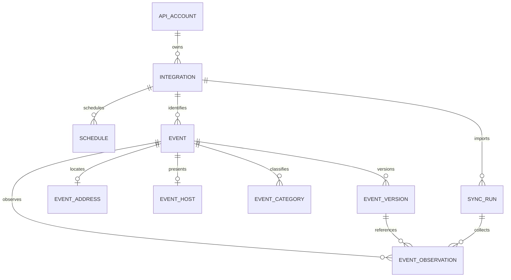

# Event and Demographic Intelligence

A relational business database fed by modular integrations and sales-file uploads. It combines
Sympla events, IBGE Census 2022 demographics and versioned sales evidence to support reports and
business insights for people and AI systems.

## Open the application

Start the local stack with `python start.py`, then open:

| Interface | Local URL | Purpose |
| --- | --- | --- |
| Demographic explorer | [Open explorer](http://127.0.0.1:8011/) | Age-cohort rankings, source coverage and CSV export |
| Audience map | [Open map](http://127.0.0.1:8012/map/) | Zoom, clusters, event/venue reach and demographic filters |
| Analysis workspace | [Open workspace](http://127.0.0.1:8012/map/workspace.html) | Sales uploads, scenarios, comparisons, notes, reports and alerts |
| Swagger | [Open API documentation](http://127.0.0.1:8010/docs/) | Authorize with API client credentials and test endpoints |

Use **Authorize API** in the frontend or **Authorize** in Swagger with the API client ID and secret
chosen during startup. API credentials are entered only through Swagger; no browser-native Basic
sign-in dialog is used. Tokens remain in page memory, so a new page or reload requires authorization.

## Modules and delivered capabilities

| Docker service | Responsibility |
| --- | --- |
| `db` | Shared PostgreSQL 17/PostGIS 3.7 relational database and persistent history |
| `api` | Bearer authentication, scoped permissions, integration CRUD and data APIs |
| `integration-sympla` | Independent scheduled/on-demand Sympla event collection |
| `integration-ibge` | Independent IBGE population, age and income collection |
| `frontend` | Demographic explorer, source evidence and CSV export |
| `audience-map` | Separate map/workspace module, image, server, health check and port |
| `analysis-monitor` | Local, deduplicated source-update alerts for watched scenarios |
| `routing` | Optional local OSRM car-routing engine; no public host port |

The map supports viewport queries, zoom-dependent grouping and distinct count/share/density displays.
Sales CSV uploads preserve file hashes and append correction versions. Saved scenarios retain filters,
source versions and immutable captures; compare captures or export standalone HTML reports with a map
and complete JSON evidence. Commercial notes and quality views are available in the workspace.

The national IBGE preset contains **430 municipalities**, covering the 27 capitals, including Brasilia,
and their official metropolitan regions/RIDEs. The detailed Sao Paulo source remains separate.
Geography composition is based on corrected IBGE 2025 data; demographic measurements retain reference
period **2022**. The calendar-year age shift does not model births after the census, mortality or migration.

Income filters use locality mean/median monthly income of household responsible persons with income,
in nominal BRL 2022. They do not identify people jointly satisfying an individual age/income bracket.
Sales-based insights require actual uploaded files; absence of uploaded records does not prove zero
sales or demand. No synthetic sales are inserted into the main environment.

Road-time filtering currently has a prepared **Rio de Janeiro regional extract**, not national coverage.
Times use a car profile without live traffic, parking or transit schedules. Uncovered/unroutable
locations remain unknown. Larger extracts require additional preprocessing resources; see routing setup below.

Documentation:

- [IBGE scope, indicators and import configuration](docs/ibge-integration.md)
- [Demographic explorer and cohort calculations](docs/demographic-frontend.md)
- [Independent audience map module](docs/audience-map.md)
- [Sales CSV format, analysis workflows, permissions and routing](docs/analysis-workspace.md)
- [Entity-relationship diagrams](docs/data-model.md), [program flowcharts](docs/import-flow.md)
- [Delivery status and validation](docs/integration-status.md)

Validation includes **130 PostgreSQL/PostGIS tests**, real-browser map/workspace flows and a local road
query. A local 430-municipality benchmark measured warm median computation of approximately 202 ms
before optimization and 36 ms with caching (about 82% lower latency in that test, not a production SLA).

## Relational events, integration CRUD and lineage

Project diagrams: [Entity-relationship diagram (ERD)](docs/data-model.md) and
[program logic flowcharts](docs/import-flow.md). Both documents use Mermaid and render on GitHub.

Events now have typed relational columns for their core attributes and related address, host and
primary/secondary category records. The sanitized source snapshot remains available as `data` for
compatibility and immutable change history. Date strings and coordinates retain source formatting;
no timezone or precision is inferred. They are not normalized UTC instants or numeric geographic fields.



Integration management is owner-scoped and uses independent `integrations:read`, `integrations:write`,
`integrations:edit` and `integrations:delete` permissions:

- GET/POST `/api/v1/integrations/`
- GET/PATCH/DELETE `/api/v1/integrations/{integration_id}/`
- GET `/api/v1/integration-providers/`: registered connector codes and versions

Example integration creation:

```json
{"name":"Event source","provider":"sympla","active":true,"is_default":false}
```

PATCH accepts name, active, is_default and provider-validated configuration. Provider and owner are immutable. DELETE soft-deletes
configuration, deactivates its schedules and cancels queued imports; existing events, versions and
lineage remain readable. Changing a configuration during collection prevents that result from committing.
Selecting a default does not rewrite existing schedules. Reactivating an integration preserves its
original schedules; schedules disabled by deletion cannot be restored by undeleting the integration.

Each API account receives a default Sympla integration. Sympla credentials remain encrypted and scoped
to the API account: multiple Sympla integrations for the same API account use that account's token,
not separate Sympla credentials. No arbitrary upstream URLs or dynamic code imports are accepted.
Connectors implement validated configuration, configuration_error and collect through the explicit
registry in core/connectors.py. Domain-specific normalization/persistence preserves atomic imports,
versioning and lineage; API input cannot select arbitrary code or upstream URLs.
The production registry contains Sympla event and IBGE statistical connectors.

Schedule creation and POST `/api/v1/sync/` accept an optional integration_id. Omission selects the
active default integration. Existing schedules remain linked to their migrated integration. Pending
manual imports are limited per integration. Imports still require synchronization:write independently
of integration management permissions.

- GET `/api/v1/events/`: relational event fields, related records and compatible data snapshot;
  optional integration_id and city filters.
- GET `/api/v1/events/{event_id}/`: one event with first/last observation and latest run references.
- GET `/api/v1/events/{event_id}/versions/`: immutable content changes.
- GET `/api/v1/events/{event_id}/observations/`: every successful import observation, including unchanged events.

Lineage links the source integration, external event ID, synchronization run, content version,
collection time, fingerprint and transformation version. Observations are append-only in PostgreSQL,
and runtime database permissions prohibit their modification or deletion. An import commits event
relations, versions, observations and its success status together; any failure rolls them back together.
The fingerprint covers the sanitized normalized event, not an unsanitized upstream HTTP response.

Migration preserves event identifiers, historical versions, API credentials and existing schedules.
Known historical versions produce observations marked evidence_type=legacy_version and
transformation_version=legacy.snapshot.v1, using the original version-record timestamp. Those are
reconstructed evidence, not newly verified fetch times. Previous unchanged imports cannot be reconstructed;
new imports record them from this version onward. Missing events are not inferred to be deleted.

## Start

The [demographic frontend](docs/demographic-frontend.md) runs in its own container at
**http://127.0.0.1:8011/**. Search imported IBGE age cohorts by location and analysis year, inspect
calculation bounds and provenance, and export CSV. Ages are aligned by the calendar-year difference
from the source census; this does not model births, deaths or migration.

Requirements: Python 3.11+ on the host (including local routing preparation) and Docker Desktop/Engine with Linux containers and Docker Compose v2.
The API and integration containers run on Python 3.13 in Docker. A host virtual environment is not required.

```powershell
python start.py
```

In this workspace, C:\Dev\ticketing_sympla\start.py forwards to the maintained release checkout.
In a Git clone, use start.py from the repository root. The launcher prints the configuration path.

First launch prompts in English for the database account name/password, API client ID/secret, and an optional
Sympla provider token. Password input is hidden and confirmation is required. Invalid passwords explain
the rules and prompt again: **8 to 16 characters, uppercase, lowercase, digit and special character**;
printable ASCII only, no spaces. Database credentials and API credentials are separate.

The launcher builds the module images, starts PostgreSQL/PostGIS, applies migrations, configures a
restricted runtime database role and the protected master API account, then starts the API, provider
workers, frontend modules and analysis monitor. A prepared routing graph starts when enabled. Subsequent launches
reuse credentials and persistent data. You may close the terminal after the Ready message.

Swagger: **http://127.0.0.1:8010/docs/** (also /swagger/).

## Configuration

Edit config.jsonc before first launch. Comments and trailing commas are supported.

```jsonc
{
  "database": { "name": "Simpla", "port": 2424 },
  "api": { "port": 8010 },
  "frontend": { "port": 8011 },
  "audience_map": { "port": 8012 },
  "routing": { "enabled": true, "region": "rio-de-janeiro" },
  "auth": { "token_ttl_seconds": 3600 },
  "docker": { "project_name": "sympla" }
}
```

PostgreSQL is published on host port 2424; containers connect to db:5432 internally.
PostgreSQL, the API and both frontend entry points bind only to 127.0.0.1. Ports must be distinct;
changes apply on the next launch. OSRM is internal to the Docker network.
Changing the database name/project after initialization is blocked: start.py never silently renames,
replaces or deletes existing databases. Plan an explicit migration or a separate new instance instead.

Credentials live under .local/, excluded from Git and Docker builds. The launcher restricts this directory
to the current operating-system account (and SYSTEM on Windows). Individual files are mounted as Compose secrets; passwords
are not Docker command arguments or environment values. The API client secret bootstrap file is cleared
after its password hash is saved. Database and Django secret files must remain available for restarts.
Protect this directory and backups of it and the PostgreSQL volume.

If omitted during setup, run python start.py --configure-sympla for the master account.
No provider credential is included in the code. Old SQLite/prototype data is not imported automatically.

```powershell
python start.py --check
python start.py --logs
python start.py --stop
python start.py --reset-api-client
python start.py --prepare-routing
```

Stop preserves database volumes. Reset prompts for a new API client secret and invalidates existing
tokens. The launcher never deletes volumes automatically. Use --config PATH --state-dir PATH with
a distinct Docker project and ports to isolate another instance.

## Sales upload and local routing setup

In the analysis workspace, select an owned event and edition, download the CSV template and upload
UTF-8 data with these columns, in this order:

```csv
sale_id,sold_on,municipality_code,tickets,revenue
order-line-001,2026-11-01,3550308,2,120.00
```

The municipality is the declared ticket/buyer-origin IBGE code, not the venue location. Limits are
5 MiB and 10000 rows. Dates use YYYY-MM-DD; revenue is a nonnegative BRL line total with a decimal point.
Blank origins are allowed and remain unresolved. Do not upload names, emails or personal profiles.
Re-uploading the same file is idempotent; corrections to an event/edition/sale ID append a version.
Omitted rows are retained. See the [full CSV contract](docs/analysis-workspace.md#sales-csv).

For road-time filtering on a new machine, choose the routing region in config.jsonc and run:

```powershell
python start.py --prepare-routing
```

The default regional graph is Rio de Janeiro. Supported larger extracts are `sudeste` and `brazil`;
the compressed files are approximately 823 MB and 2 GB, with substantially larger preprocessing RAM
requirements. National preparation is unsuitable for the current 8 GiB Docker allocation. Increase
resources before choosing it. Existing graphs are reused; no graph is silently downloaded at normal
startup. Missing graphs do not block demographic exploration, but cannot provide road-time results.
Graph files live under routing/data/, excluded from Git and Docker builds, and contain no API credentials.

## Authentication and Swagger

**API client ID = client_id. API password = client_secret.** These credentials are exchanged for an
expiring opaque Bearer token through the client credentials flow. They are separate from both the
Sympla provider token and the database credentials.

In Swagger, click Authorize, enter the client ID and client secret chosen during startup, then click
Authorize again. Swagger calls POST /api/v1/token/ and attaches the returned token to API requests.
You do not need to generate/paste the token manually. Authorization is not persisted across reloads.
When the token expires, authorize again.

Direct clients may call:

```http
POST /api/v1/token/
Content-Type: application/json

{
  "grant_type": "client_credentials",
  "client_id": "your-client-id",
  "client_secret": "your-client-secret"
}
```

The response contains access_token, token_type (Bearer) and expires_in in seconds (default 3600).
Subsequent requests use Authorization: Bearer <access_token>. Form-urlencoded and HTTP Basic client
authentication are also supported for OAuth tooling. Do not put credentials in query strings.
There are no password grants, refresh tokens or arbitrary scopes. Rate limit: 10 token requests per
minute per source IP; follow Retry-After on 429. Client rotation/revocation invalidates tokens immediately.
Old non-expiring static tokens are no longer accepted. Only password hashes and token digests are stored;
API logs never record token request/response bodies or authorization headers.

The first API account is the single protected master. Operators can provision additional clients with the administrative
management command api_user create CLIENT_ID (read-only) or api_user create CLIENT_ID --write, or
rotate/revoke existing clients. Those commands require the migration-owner database connection.
There is no anonymous client-registration endpoint.

OpenAPI: /openapi.json. Swagger assets are bundled locally, without an external CDN/validator.
DJANGO_DOCS_ENABLED=false disables the documentation, schema and assets.

## API

Except for the token endpoint, all /api/v1/ routes require an access token. Write operations require
the corresponding section:action permission. Lists accept page and page_size (1 to 100).

| Method | Route | Purpose |
| --- | --- | --- |
| POST | /api/v1/token/ | Exchange client credentials for a token |
| POST | /api/v1/schedules/ | Create a daily active/inactive schedule |
| GET | /api/v1/schedules/?active=true | List active schedules; omit filter for both states |
| PATCH | /api/v1/schedules/{id}/ | Activate/deactivate with {"active":true} |
| DELETE | /api/v1/schedules/{id}/ | Soft-delete either state and cancel queued occurrences |
| POST | /api/v1/sync/ | Send {} to queue a manual import; returns 202 and run ID |
| GET | /api/v1/sync-runs/ | Read status, counts and safe error codes |
| GET | /api/v1/events/ | Read current events |
| GET | /api/v1/events/{id}/versions/ | Read versions and field differences |
| GET | /api/v1/audit-logs/ | Read changes; filters: resource, target_id, actor |
| GET | /api/v1/request-logs/ | Read access history, including denied attempts |
| GET | /api/v1/demographics/ | Read owned IBGE statistics and their reference periods |
| GET | /api/v1/demographics/map/ | Filter map cohorts, locality income, venue reach and road time |
| GET/POST | /api/v1/sales/uploads/ | Inspect import provenance or upload a versioned sales CSV |
| GET | /api/v1/sales/summary/ | Read recorded origins and compare event editions |
| GET/POST | /api/v1/analysis/scenarios/ | List scenarios or save filters with an immutable capture |
| GET/PATCH/DELETE | /api/v1/analysis/scenarios/{id}/ | Inspect, revise or archive an owned scenario |
| GET/POST | /api/v1/analysis/scenarios/{id}/snapshots/ | List or capture reproducible analysis evidence |
| GET | /api/v1/analysis/scenarios/{id}/report/ | Export captured JSON or standalone HTML with a map |
| GET | /api/v1/analysis/scenarios/{id}/opportunities/ | Compare a cohort scenario with uploaded municipal tickets |
| GET | /api/v1/analysis/compare/ | Compare 2–5 scenario snapshots |
| GET/POST | /api/v1/analysis/notes/ | Read or create commercial annotations |
| GET | /api/v1/analysis/alerts/ | Read local source-update alerts |
| GET | /api/v1/analysis/quality/ | Inspect source freshness, missing data and recent imports |

Schedule example: {"time":"09:30","timezone":"Europe/Lisbon","active":true}.
Each recurs daily in its explicit IANA zone. Confirmed means active. Maximum 100 nondeleted schedules;
duplicate time/zone pairs return 409. Deactivation/deletion cancels queued scheduled jobs, while running
jobs finish. /ping/ is public process liveness. The unsafe legacy /update/ route is removed.

## Synchronization and recovery

The Sympla and IBGE workers run automatically in separate containers, each checking its provider
schedules every five seconds between imports.
Manual jobs require no schedule and may queue behind scheduled jobs; a second unfinished manual job
returns 409 for that integration. Provider-specific running slots prevent overlapping imports within
the same provider while allowing Sympla and IBGE collection to run independently. After downtime, one overdue occurrence
per schedule is queued; missed days are coalesced. DST gaps are skipped; ambiguous times run once.

Every upstream page is validated before an atomic database import. New events start at version 1;
identical documented data creates no version. Changes preserve snapshots and before/after field
values with JSON Pointer paths. Events absent from later responses are retained: absence does not
prove deletion or cancellation. Current events use allowlisted JSON fields and string external IDs.
The original SQL file is historical design material; Django migrations are the implemented schema.
Sales records are imported through the separate CSV upload API. Ticket checkout, payment processing
and automatic attendee ingestion are not implemented.

If a worker is interrupted during a run, its running slot remains held. Stop and verify all workers,
then use recover_sync RUN_UUID --workers-stopped with an administrative connection before restarting.
This avoids an old worker committing after a replacement. Failures remain visible in sync-runs.

## Security and deployment

The supplied stack is a local loopback deployment: DEBUG=false, with HTTP explicitly enabled for local
testing and PostgreSQL TLS disabled on its private Docker connection. Remote production requires HTTPS,
trusted forwarding, appropriate database TLS, edge rate limits, backups, retention and monitoring.
Do not expose the local stack as-is.

API/worker run as non-root containers with a read-only filesystem and no extra capabilities. The runtime
DB role is not a superuser and cannot update/delete audit/version history or truncate tables. History
also has append-only triggers; DB owners can still change protections. Business changes and audit
evidence commit together, with historical actor names preserved.

Sympla requests only target HTTPS api.sympla.com.br; redirects/environment proxies are disabled.
Pagination, bytes, event count and elapsed-time checks are bounded. Connection/read timeouts are used,
not a hard process deadline. Safe error codes replace upstream bodies and tracebacks. Restrict access
to event text and sanitize HTML before rendering it in another UI.

See VALIDATION.md. A real authorized Sympla staging import remains required before production.
## Troubleshooting imports and logs

A 202 response with status queued means only that a job was accepted, not that events were imported.
The manual response includes status_url. Follow GET /api/v1/sync-runs/{run_id}/ until status becomes
success, partial or failed. GET /api/v1/sync-runs/ lists all scheduled and manual runs. Failures include
error_code and error_details with an English message and, for upstream HTTP errors, the status/page.
Upstream bodies, authorization headers and pagination cursors are never included in these diagnostics.

If the account provider token is missing, manual sync returns 503 before queuing.
The master may use python start.py --configure-sympla; ordinary API accounts use their own identity provider-token endpoint.
Reconfigure only after active imports finish. The Sympla token is separate from your API client secret.

From the workspace root:

```powershell
python start.py --logs
```

Direct Docker commands are also available:

```powershell
docker logs --tail 100 -f sympla-integration-sympla-1
docker logs --tail 100 -f sympla-integration-ibge-1
docker logs --tail 100 -f sympla-analysis-monitor-1
docker logs --tail 100 -f sympla-routing-1
docker logs --tail 100 -f sympla-api-1
```

GET /api/v1/audit-logs/ contains persisted business changes and failures. GET /api/v1/request-logs/
contains HTTP access records. These tables remain in PostgreSQL when containers restart; Docker's
stdout logs belong to the container and may be replaced when containers are recreated.
Sympla cursor pagination permits terminal pages containing only quantity and page_size: no next_cursor
means there is no next page. The importer supports that response even for a single-page/empty result.

## Identity, roles and API account-owned Sympla accounts

The terminal identity is the single protected master. It cannot be demoted, disabled, deleted or have
its credentials revoked through HTTP. Use start.py --reset-api-client for master credential changes.
Ordinary roles never grant protected master status. Administration can be delegated with scoped permissions.

In Swagger, first create a custom role under Authorization:

```json
{"name":"Schedule editor","permissions":["schedules:read","schedules:edit"]}
```

Then POST /api-users under Identity:

```json
{
  "client_id":"another-person",
  "role_identifier":"UUID returned when the role was created",
  "sympla_token":"that person's own Sympla provider token"
}
```

The new client secret is generated and returned once; an optional client_secret may instead be provided
if it meets the password policy. The new person uses their client ID and secret with Swagger Authorize.
Provider tokens and credential hashes are never returned by identity reads or written to audits.
Every new ordinary identity must supply its own Sympla token; there is no master/global fallback.
The bootstrap master may initially omit its provider token and configure it later.

Permissions combine an API section and an action, for example `identity:write` or `schedules:edit`.
`read` permits GET, `write` permits creation POST, `edit` permits PUT/PATCH, and `delete` permits DELETE.
Credential replacement POST uses `identity:edit`. Permissions are independent and additive across the
role and individual grants. A role with `identity:write` can create API accounts; it cannot edit or
delete them without the corresponding grants. The same applies to custom roles and schedules.

| Section | API resources |
| --- | --- |
| identity | API account records, role assignment, credentials and provider token |
| roles | Custom role creation, metadata and role permission replacement |
| authorization | Permission catalogue and individual access grants |
| integrations | Owned integration configurations and registered connector catalogue |
| demographics | Imported IBGE geography, population, age, income and statistical lineage reads |
| schedules | Daily schedules |
| synchronization | Manual imports and synchronization runs |
| events | Imported events and immutable versions |
| audit | Audit and HTTP request logs |
| sales | Owned CSV uploads, sales summaries and opportunity evidence |
| scenarios | Saved scenarios, immutable captures, commercial notes and local alerts |
| reports | Historical report exports and scenario comparisons |

GET /permissions returns each code with its section, action and description. The catalogue contains
four actions per section; actions without a matching endpoint do not grant additional behavior.
Swagger documents the exact required code for every protected operation. A denied call returns 403
and required_permission. Authentication and GET /me require no resource grant: valid active API
credentials can always obtain their own Bearer token. GET /api-users/{identifier} requires identity:read.

Delegated administrators can create roles, assign roles and grant permissions only within their own
effective permissions. Replacing an existing role's permissions also requires authority over its
current permissions. Reissuing credentials cannot impersonate a more privileged API account.
The master remains protected, and system roles remain immutable.

Scheduled and manual imports require synchronization:write, including the worker's final authorization
check. Creating a schedule requires schedules:write; grant both to an API account expected to import
on its schedules. synchronization:read permits inspecting job results independently.

The migration expands old global permissions into equivalent operational permissions only. It grants
no identity, role or authorization administration to existing ordinary API accounts. Credential IDs,
client secrets, imported records and immutable history are preserved.

Identity routes use immutable UUID identifiers:

- GET /me
- POST/GET /api-users
- GET/PATCH/DELETE /api-users/{identifier}; DELETE is a soft deletion
- GET /api/users/{identifier}, the individual lookup alias
- PUT /api-users/{identifier}/role
- POST /api-users/{identifier}/credentials with {} to return a replacement secret once
- DELETE /credentials/{identifier}
- PUT /api-users/{identifier}/sympla-token with {"sympla_token":"replacement"}

Authorization routes:

- GET /permissions: scoped section:action catalogue (authorization:read)
- POST/GET /roles; GET/PATCH/DELETE /roles/{identifier}
- PUT /roles/{identifier}/permissions with {"permissions":[...]}
- PUT /api-users/{identifier}/permissions: replace individual grants without changing the role
- POST/GET /access-rules; DELETE /access-rules/{identifier}

The reader/operator/master system roles are immutable; custom roles are editable. Referenced roles
cannot be deleted. identity:read permits inspecting public API account metadata. The master can inspect all audit/access logs; ordinary API accounts with audit:read see only their own logs. Provider-derived data and schedules are owner-scoped,
including the master's normal operational routes. The same external event ID/time can exist for two
API accounts without sharing data or conflicting.

Role assignments, grant changes, account status changes and credential changes invalidate affected
access tokens. Reauthorize after an approved role/grant change. Losing synchronization:write permission or deactivation
cancels queued imports. Authority and the provider version are checked again before a running import
commits; changes during an upstream fetch prevent a stale result from being saved.

Provider tokens are encrypted in PostgreSQL using Fernet authenticated encryption. The key lives
separately in .local/provider_encryption_key, mounted as a Docker secret. Back up that key with the DB;
a replacement key cannot decrypt existing values. Startup refuses to regenerate a missing initialized
key. identity:edit permits updating ordinary API account provider tokens. Only the master can update its own provider token. Normal restarts preserve API-updated credentials.
The raw master setup secret is available only to the bootstrap container, not API/worker containers.

The ownership migration assigns previously global events, schedules and runs to the original master.
Historical immutable audit records remain unchanged and unscoped legacy evidence is master-only.
Other legacy accounts retain reader/operator operational rights but must configure their own provider
credentials. Startup automatically supplies INITIAL_CLIENT_ID for the migration, stops API/worker
before structural changes and restarts them afterward. The worker drains its current import on shutdown.

The master provider setup file is cleared after its encrypted value is saved. Retain the encryption key and database backups.

## Swagger authentication behavior

Swagger Authorize is the single API credential entry point. A failed token exchange returns a safe
API error and a Bearer challenge, never a Basic challenge that opens the browser-native sign-in dialog.
Swagger omits cached browser authentication credentials; the explicit API Bearer header still authorizes
protected calls. The existing API client ID and selected API secret are preserved through upgrades.
Application identifiers distinguish API accounts, database accounts and operating-system accounts.
Historical SQL column names are mapped explicitly rather than changing credential data or applied history.
