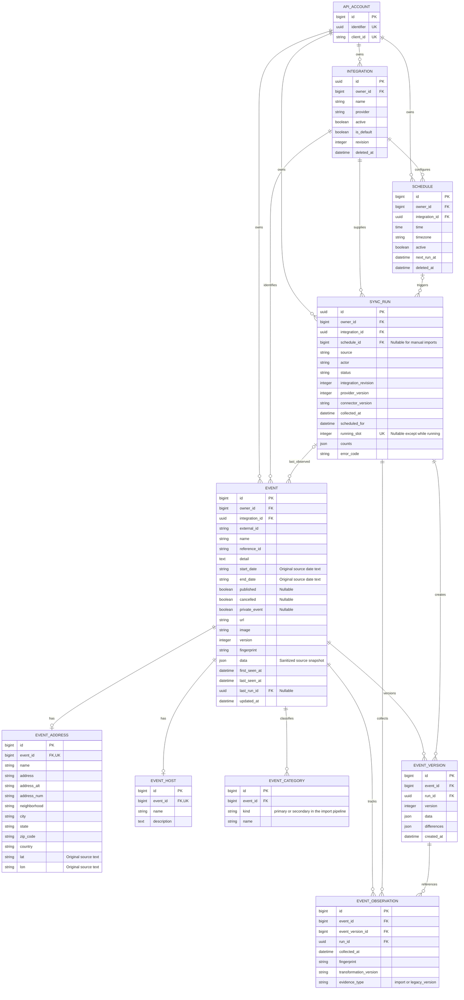
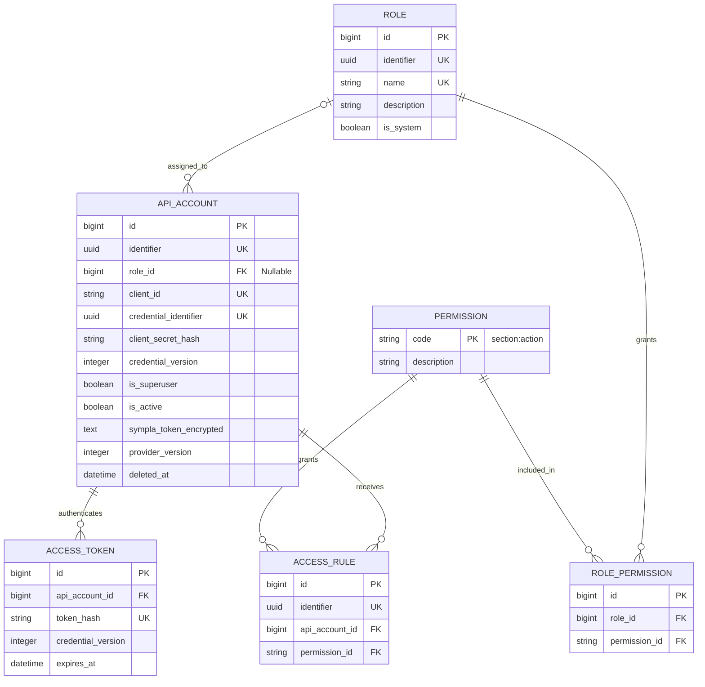
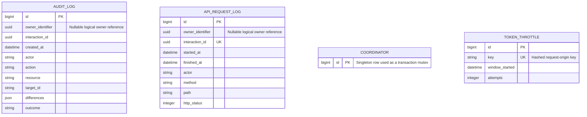

# Entity-relationship diagram (ERD)

This document describes the implemented database schema. Diagrams use Mermaid and render directly
on GitHub. Field lists highlight keys and business attributes; the complete field definitions are in
[models.py](../ticketing_sympla_app/core/models.py). `PK` means primary key, `FK` means foreign key,
and `UK` means unique key. Crow's-foot ends indicate many records; a circle indicates an optional record.

## Events, integrations and lineage

Every event is identified within its integration: `(integration_id, external_id)` is unique.
Different integrations can hold the same external event ID. Events, schedules and runs also retain
their API account owner; the application validates matching ownership before collecting and committing.

| Record | Additional uniqueness rule |
| --- | --- |
| Integration | Live name per owner; at most one live default per owner |
| Schedule | Live `(owner_id, integration_id, time, timezone)` |
| SyncRun | `(schedule_id, scheduled_for)`; one global running slot |
| EventCategory | `(event_id, kind)` |
| EventVersion | `(event_id, version)` |
| EventObservation | `(event_id, run_id)` |

An observation records that an import saw an event, even when the content did not change. It references
the existing content version in that case. A new content version is created only when the fingerprint changes.
Versions and observations are append-only. Legacy observations reconstructed from old versions use
`evidence_type=legacy_version`; their timestamps are original version-record times, not verified fetch times.

Deleting an integration is a soft deletion: events and history remain readable. Address, host and category
rows are the current relational projection; prior values remain in immutable version snapshots.
Source date strings and coordinates retain source formatting; they are not normalized UTC instants or numeric coordinates.

## API identity and authorization

`ROLE_PERMISSION` is Django's generated many-to-many join table, unique by role and permission.
`ACCESS_RULE` is unique by API account and permission. Effective permissions are the union of role and
individual grants; the protected master receives the entire permission catalogue. Token generation
requires valid API client credentials independently of resource permissions.

`API_ACCOUNT` is the qualified diagram label for the existing `ApiUser` model and `core_apiuser` table.
For compatibility, `client_id` maps to the historical `username` SQL column, and AccessRule/AccessToken
`api_account_id` maps to the historical `user_id` SQL column. Those physical names do not define separate entities.
The Sympla token belongs to the API account and is shared by that API account's Sympla integrations.

## Audit and coordination records

These four tables have no declared foreign keys. Audit ownership, target IDs and interaction IDs are
logical references; they must not be drawn as database-enforced relationships. Audit and HTTP request
logs are append-only. Framework-managed Django tables are outside the scope of these application diagrams.

See [the program flowcharts](import-flow.md) for the runtime decisions that populate these records.
