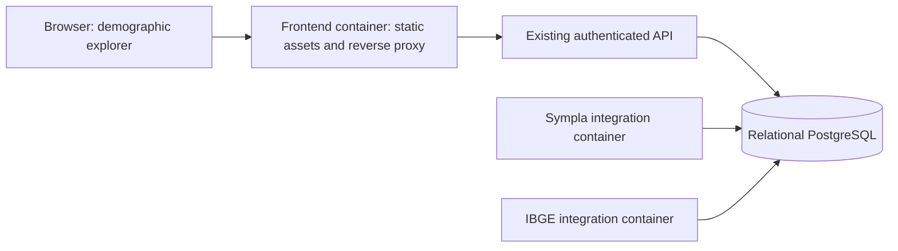

# Demographic frontend and age-cohort search

The `frontend` service is an independent static frontend container. Its same-origin reverse proxy
forwards API and Swagger requests to the existing API container; the frontend has no database or
provider credentials. Start the complete stack with `python start.py` and open
`http://127.0.0.1:8011/`. Configure the port in `config.jsonc` under `frontend.port`.



## Authorization

Choose **Authorize API**, then use the existing **Authorize** form in embedded Swagger with the API
client ID and client secret. Swagger remains the only interactive API credential form. A successful
token exchange transfers the Bearer token only to the matching same-origin parent frame using a random
connection identifier and exact frame/origin checks. Ordinary Swagger pages remain non-embeddable;
the explicit connection view permits same-origin embedding only.

The frontend retains the token in memory until expiry or Disconnect. It does not put API credentials
or tokens in URLs, localStorage, sessionStorage or cookies. Refreshing the page requires authorization
again. No application-account login or native HTTP Basic authentication dialog is introduced.
API requests require `demographics:read`, and results remain scoped to owned integrations.

## Search and interpretation

Select the imported integration, target ages, analysis year and official geographical level. State and
municipality filters narrow the comparison. Districts remain distinct from neighborhoods: an empty
neighborhood result is not silently replaced by a district result. The Sources & coverage view shows
availability from the most recent imported coverage evidence of the selected integration.

Age alignment uses:

```text
years_advanced = analysis_year - source_year
aligned_age_min = source_age_min + years_advanced
aligned_age_max = source_age_max + years_advanced
```

The default analysis year comes from the current calendar year in Europe/Lisbon, not a fixed four-year
constant. For example, 0–4 in Census 2022 maps to the 4–8 cohort in 2026 and to 5–9 in 2027. This is
a calendar-year alignment of the observed census cohort, not a current population forecast. It does not
account for deaths, migration or individual birthdays. No imported statistic or source version is changed.

| Search situation | Result |
| --- | --- |
| Entire closed source age bands are included | Exact sum of those observed source cohorts under the annual alignment |
| A source band is only partly included | Lower bound includes complete bands; upper bound also includes all intersecting partial bands |
| Proportional estimation explicitly enabled | Closed-band count multiplied by the fraction of its whole age years intersected; uniform distribution is an assumption |
| Target ages include post-census births | Incomplete coverage; no finite upper bound or manufactured birth count |
| A required source band is missing or suppressed | Incomplete coverage; missing counts are never treated as zero |
| A requested interval cuts the open-ended age band | Bounds are available if the count is published; no proportional split is manufactured |

Example: source 0–4 has 100 people and 5–9 has 200. In 2026 their aligned bands are 4–8 and 9–13.
Searching for ages 6–10 gives bounds 0–300. With proportional estimation enabled, the result is
`100 × 3/5 + 200 × 2/5 = 140`. The 140 is an assumption-based cohort estimate, not a newly measured
IBGE population. Searching 0–3 in 2026 is not covered by Census 2022 births.

Rank by confirmed lower bound, possible upper bound, confirmed share, or the optional proportional
estimate. Ties share ranks. Overlapping ranges do not establish a definite ordering of actual counts.
Shares use the source age-tabulated total, preserving the documented difference from revised basic
population totals. Geography levels are compared separately, and multiple integrations require explicit
source selection so duplicate source imports are not combined.

Calculation details show the original and aligned bands, observed counts, source statistic IDs and
versions, collection time and latest source lineage. CSV export includes filters, years, bounds,
estimate, coverage flags and method; spreadsheet formula prefixes in text are neutralized.

## API

- GET `/api/v1/demographics/explorer-options/`: available imported sources, source years and age bands.
- GET `/api/v1/demographics/search/`: validated, ranked and paginated cohort comparisons.
- GET `/api/v1/geographies/?integration_id=UUID`: source-scoped geography metadata.
- GET `/api/v1/ibge/coverage/?integration_id=UUID&latest=true`: latest source coverage evidence.

Example search:

```text
/api/v1/demographics/search/?integration_id=UUID&source_year=2022&target_year=2026&age_min=4&age_max=8&level=district&city_code=3550308
```

The search response preserves source provenance and explicitly reports `exact_band_match`, `bounded`
or `incomplete_coverage`. Search and ranking are read-only. Imported values and immutable history remain
in PostgreSQL; the frontend is an additional presentation module.

## Validation

The delivery passed 102 Django tests on PostgreSQL and the Docker startup/persistence checks.
An isolated Chromium test exercised the real Swagger authorization bridge, 96 imported São Paulo
districts, complete and partial band searches, post-census birth gaps, source lineage, CSV export,
coverage evidence, mobile overflow and memory-only authentication. No model migrations are required.

To repeat the browser test, first run `python qa/verify_docker_startup.py`, then
`python qa/prepare_frontend_qa.py`. Both operate on the disposable `sympla-startup-qa` stack.
Build `qa/browser.Dockerfile` as `sympla-frontend-browser-qa` and run it with
`--network container:sympla-startup-qa-frontend-1`; mount a writable artifacts directory at `/artifacts`.
The preparation script imports public IBGE data and needs network access. Its fixed credentials belong
only to this disposable QA stack. Never configure them for a deployed API account.
