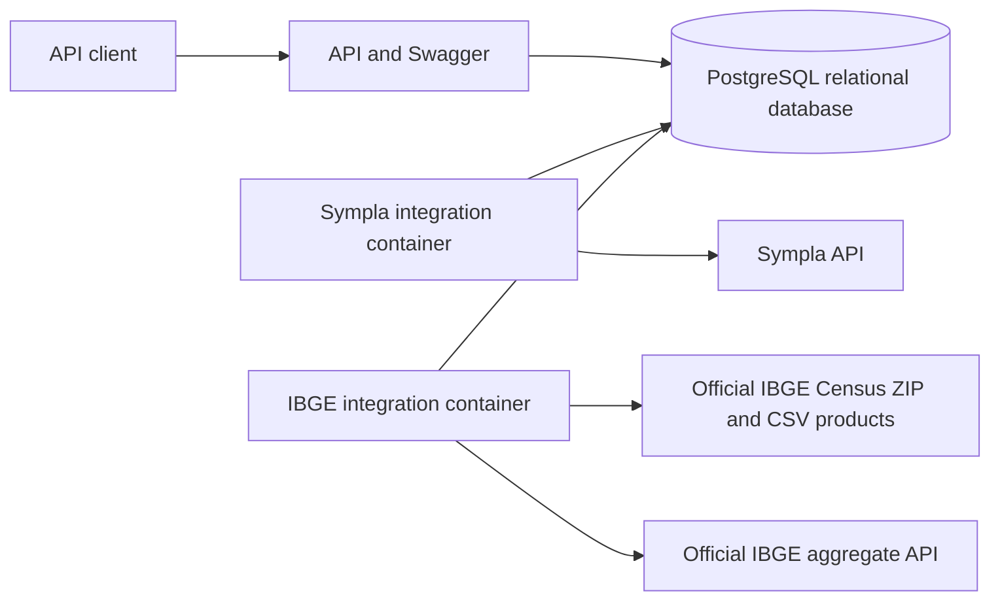

# Modular IBGE integration

The `integration-sympla` and `integration-ibge` Docker services have independent images, processes,
provider-filtered queues and worker health checks. Both persist through the same relational PostgreSQL
database. The API provides authentication, integration CRUD, schedules and read endpoints. IBGE needs
no provider token and its container does not mount the Sympla provider encryption key.



Provider modules live under `core/integration_modules/sympla` and `core/integration_modules/ibge`.
The shared registry describes the domain, public/account credential scope and provider running slot.
One Sympla import and one IBGE import may collect concurrently; workers never claim the other provider's
jobs. Existing Sympla event tables, credentials, versions and schedules are preserved.

## Configure São Paulo/SP

POST `/api/v1/integrations/` with `integrations:write`:

```json
{
  "name": "IBGE - São Paulo/SP",
  "provider": "ibge",
  "configuration": {
    "state_codes": ["35"],
    "municipality_codes": ["3550308"],
    "levels": ["state", "city", "neighborhood"],
    "include_districts_when_no_neighborhoods": true
  }
}
```

POST `/api/v1/sync/` with `synchronization:write` and
`{"integration_id":"UUID returned when creating the integration"}`. The same integration_id may be
used when creating a daily schedule. PATCH integration configuration requires integrations:edit and
invalidates an in-flight result through the integration revision check.

At most 27 state codes and 10 municipality codes may be selected per integration. City/neighborhood
imports require explicit municipality codes. A state import always covers all municipalities of that
state when summing population and age, even if only one city was selected separately.

## Indicators and coverage

| Indicator | Unit and interpretation |
| --- | --- |
| population | Persons, from the official basic product, variable V0001 |
| age_population | Persons in the source age bands, V01031 through V01041; category total uses V01006 |
| responsible_income_mean | Nominal monthly BRL in 2022, mean for responsible persons with income, V06004 |
| responsible_income_median | Nominal monthly BRL in 2022, median for responsible persons with income, V06006 |
| household_per_capita_income_mean | State indicator from SIDRA 10295, when the official API is available |
| household_per_capita_income_median | State indicator from SIDRA 10295, when the official API is available |

The source age bands are 0–4, 5–9, 10–14, 15–19, 20–24, 25–29, 30–39, 40–49, 50–59, 60–69 and 70+.
The pipeline does not split those groups into unsupported ages. Revised basic totals and the demography
release can differ; each total is retained, and `age_universe_differs` is recorded. Use the age total
as the denominator when calculating percentages within the age product.

Income indicators describe different populations and cannot be treated as interchangeable. The current
responsible-person product publishes means and medians, not a population distribution by salary band.
This integration does not manufacture salary bands, household per capita values for neighborhoods,
or joint age/income distributions. Municipal means and medians are never averaged to create state income.

The official neighborhood product contains no records for municipality 3550308 (São Paulo) at the
validated release. Its 96 official districts may be imported as `level=district`; they are never relabeled
as neighborhoods. `level=neighborhood` remains empty for this scope and coverage reports the reason.
Other municipalities with official neighborhood records are imported at the neighborhood level.

`partial` is a completed import with explicit coverage gaps, suppressed values or different source
universes. Source API failures may leave valid population, age and local income data committed while
state income is marked unavailable. Previously stored values retain their last observation timestamp;
they are not refreshed when their source cannot be read. An invalid primary archive or failed persistence
transaction marks the run failed and commits no new statistics. Missing/suppressed values remain null;
only the official zero symbol `-` is mapped to zero.

## Query the stored data

All routes require `demographics:read` and expose only statistics belonging to the caller's integrations:

- GET `/api/v1/geographies/?level=city&code=3550308`
- GET `/api/v1/demographics/?level=city&code=3550308&indicator=population`
- GET `/api/v1/demographics/?level=city&code=3550308&indicator=age_population`
- GET `/api/v1/demographics/?level=district&indicator=responsible_income_mean`
- GET `/api/v1/demographics/{statistic_id}/versions/`
- GET `/api/v1/demographics/{statistic_id}/observations/`
- GET `/api/v1/ibge/coverage/?run_id=UUID`

Responses retain geography codes, indicator definitions, statistical universes, units, period and
last observation. Monetary values are exact decimal strings; person counts are integers. Provenance
includes the official source URL, downloaded artifact SHA-256, original variable codes, transformation
version and synchronization run. Versions, observations, source records and coverage evidence are append-only.

## Official sources and validated mappings

Reference period is Census 2022, not the current calendar year. Release dates in filenames describe
publication revisions, not new annual population measurements. Downloads are restricted to official
IBGE hosts and bounded ZIP/CSV reads; API callers cannot supply arbitrary URLs or executable adapters.

- [Census 2022 aggregate products](https://ftp.ibge.gov.br/Censos/Censo_Demografico_2022/Agregados_por_Setores_Censitarios/)
- [Responsible-person income products](https://ftp.ibge.gov.br/Censos/Censo_Demografico_2022/Agregados_por_Setores_Censitarios_Rendimento_do_Responsavel/)
- [Population and age dictionary, release 2026-11-13](https://ftp.ibge.gov.br/Censos/Censo_Demografico_2022/Agregados_por_Setores_Censitarios/dicionario_de_dados_agregados_por_setores_censitarios_20261113.xlsx)
- [Income dictionary, release 2026-05-08](https://ftp.ibge.gov.br/Censos/Censo_Demografico_2022/Agregados_por_Setores_Censitarios_Rendimento_do_Responsavel/dicionario_de_dados_renda_responsavel_20260508.xlsx)
- [SIDRA 10295 metadata](https://servicodados.ibge.gov.br/api/v3/agregados/10295/metadados)

The pinned archive names and variable mapping are maintained in `integration_modules/ibge/catalog.py`.
New official revisions require a reviewed mapping update rather than silently switching datasets.

## Validation on 2026-11-16

- 84 automated tests passed against isolated PostgreSQL, including provider queue isolation, public IBGE
  collection without a Sympla token, relational persistence, revisions, source failures and append-only history.
- The populated legacy-database migration and Docker startup/restart/persistence checks passed.
- A live São Paulo/SP import stored 1,468 statistical values and corresponding observations, including
  the city, state population/age and 96 explicitly identified districts. The city's revised basic population
  was 11,451,999; the responsible-person mean monthly income was BRL 4,961.95 in nominal 2022 values.
- The live run completed as partial: state income was unavailable from the official API, São Paulo had
  no neighborhood records in the selected source, and age/basic totals retained their different universes.
- Existing Sympla events, immutable versions, schedules, API credential hashes and encrypted provider
  tokens were compared before and after deployment and preserved. A private pre-migration backup was created.
- API, PostgreSQL and both dedicated provider containers were healthy after deployment.
