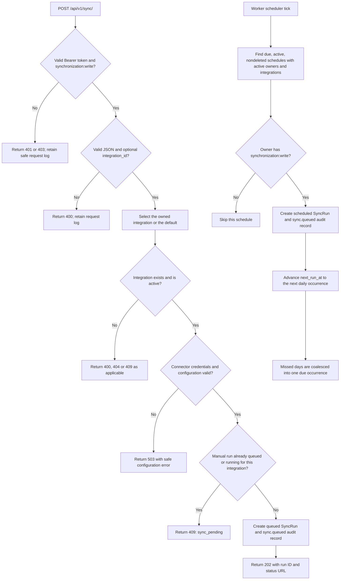
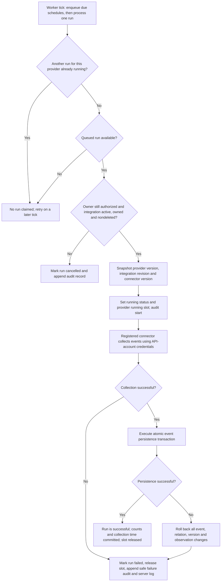
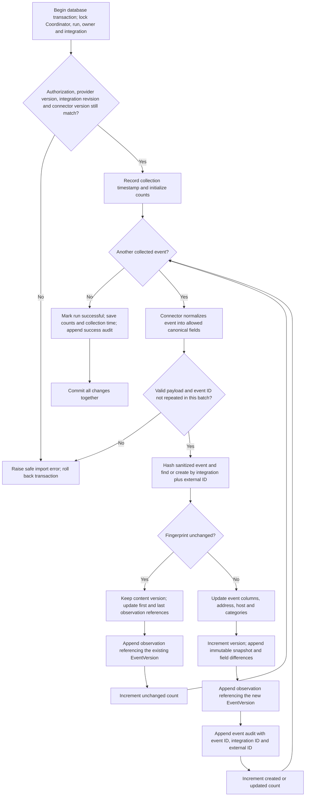
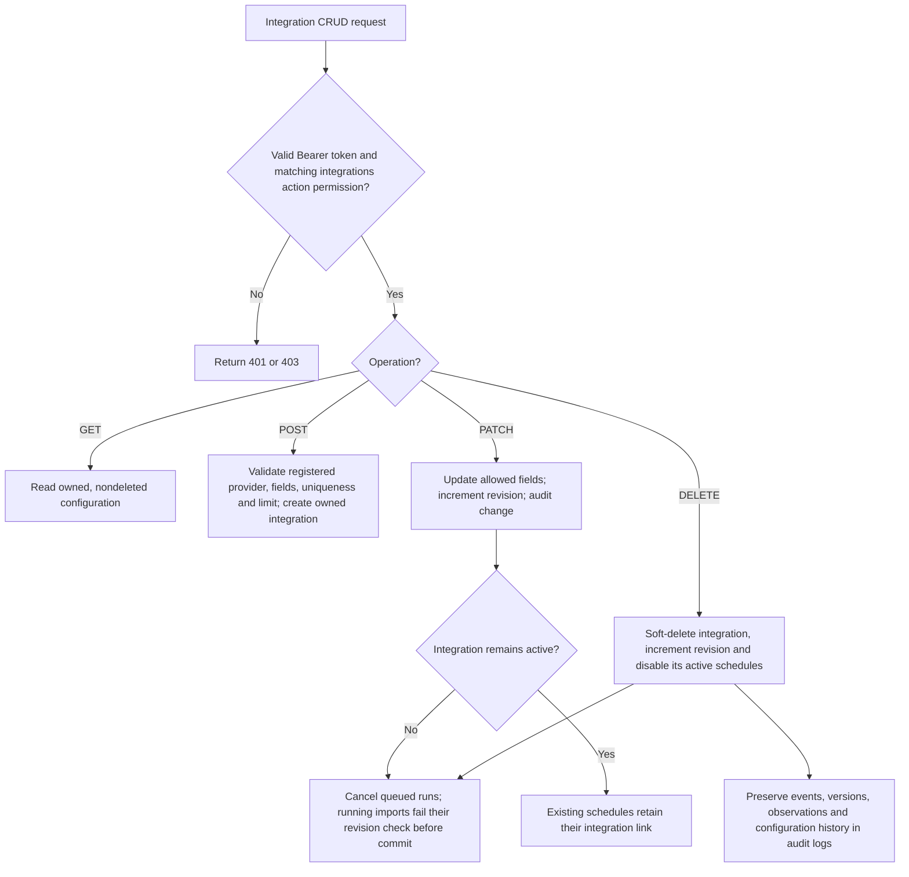
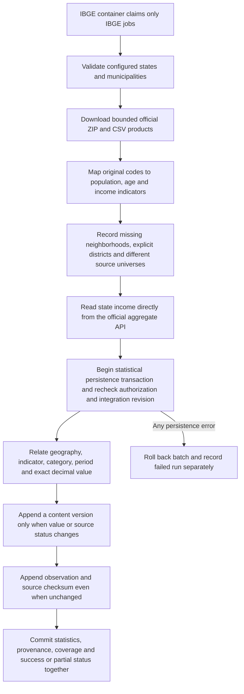

# Program logic flowcharts

These Mermaid diagrams describe the implemented logic in [views.py](../ticketing_sympla_app/core/views.py),
[services.py](../ticketing_sympla_app/core/services.py),
[connectors.py](../ticketing_sympla_app/core/connectors.py) and
[integrations.py](../ticketing_sympla_app/core/integrations.py).
They render directly on GitHub. Read the [ERD](data-model.md) for tables, keys and cardinalities.

## Manual and scheduled entry points

Queue and schedule updates use short database transactions and the Coordinator row lock. A successful
manual response confirms queuing, not that events have been imported. Duplicate scheduled occurrences
are prevented by the schedule/time uniqueness constraint. The persistent worker sleeps five seconds
between ticks after finishing its current work; external collection may therefore delay the next tick.

## Worker execution

The network request runs outside the persistence transaction. Claiming uses the Coordinator lock and
a unique provider running slot, so one import per provider runs at a time. Changing provider credentials,
integration configuration or authorization during collection prevents stale data from committing.
The version values are captured when the worker claims a job, rather than when the job is queued.

## Atomic persistence and event versioning

Any exception in normalization, projection, version creation, observation creation or auditing rolls
back the entire persistence transaction. The worker then writes the failed run status and safe failure
evidence in a separate transaction. An empty successful response completes with zero received events;
an event missing from a response is not inferred to be deleted.

An unchanged event still receives an immutable observation. Historical observations reconstructed
by migrations are marked `legacy_version` and are separate from new `import` observations.

## Integration lifecycle

GET requires `integrations:read`, POST requires `integrations:write`, PATCH requires
`integrations:edit`, and DELETE requires `integrations:delete`. Configuration mutations and their
audit records commit together. Integration management permissions do not themselves authorize an import.

## Statistical import branch

State income failures are coverage gaps, not inferred municipal averages. A completed run is partial
when official data is unavailable, suppressed or has different source universes. Sympla event imports
continue to use the event persistence branch above; statistical records never enter event tables.
